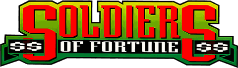
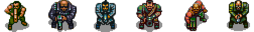
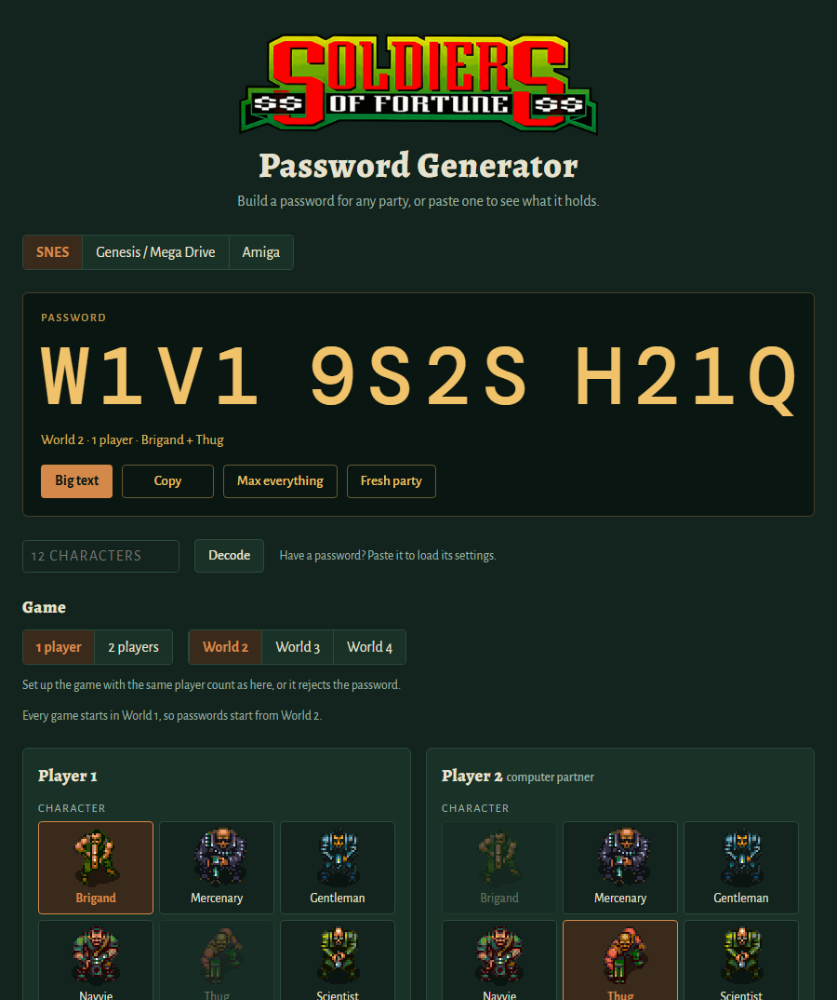
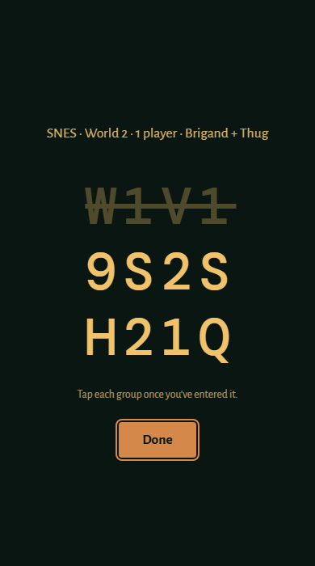
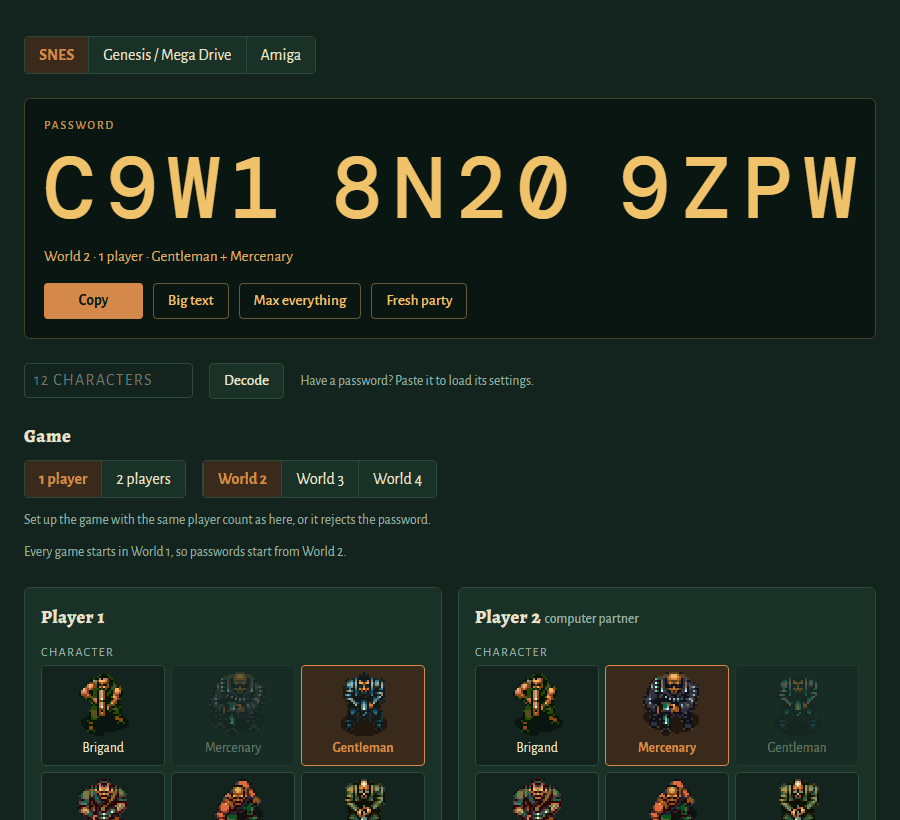

<p align="center">
  
  &nbsp;&nbsp;
  
</p>

# Soldiers of Fortune / The Chaos Engine — Password Generator

<p align="center"></p>

**[Open the password generator →](https://maxxthunder.github.io/soldiersoffortune/)**

- **Make a password** for any world, party, lives, character levels and money.
- **Decode a password** you already have to see what it holds, and fix typos.
- **Plan your shopping**: pick the gear each player wants and it works out the money they need.

It works offline too: save [`tools/sof_password_generator.html`](tools/sof_password_generator.html) and open it in a browser.

<p align="center">
  
  &nbsp;
  
</p>
<p align="center"><sub>Left: the generator. Right: <b>Big text</b>, for reading the password off your phone while you type it in.</sub></p>

## Supported versions

| Console | Released as | Passwords |
|---------|-------------|-----------|
| SNES | *Soldiers of Fortune* (US), *The Chaos Engine* (Europe) | Same for the US and European cartridges |
| Genesis / Mega Drive | *Soldiers of Fortune* (US), *The Chaos Engine* (Europe) | Same for the US and European cartridges, but different from the SNES |
| Amiga | *The Chaos Engine*, original (A500) and AGA (A1200) | Different from the consoles; only the original version takes World 1 |

For example, `W1V19S2SH21Q` on the SNES is World 2, one player: the Brigand with the Thug as the computer partner.

## If a password won't work

- **Player count.** Start the game with the same number of players as the password, or it's rejected.
- **Console.** A password only works on the console it was made for. Paste it into the generator and it says which one.
- **Typo.** Characters like B/8, S/5 and 0/Q are easy to mix up. The generator suggests fixes.
- **World 1.** Only the original Amiga version takes World 1 passwords. Every other version starts there, so its passwords start at World 2.

<p align="center"></p>

## What a password keeps

World, party, each player's lives, character level and money. Items aren't saved, but the money
includes what the equipment is worth, so you can buy it back. Shop prices are the same on every
version. [Prices →](docs/sof_password.md#shop-prices)

| Setting | Range |
|---------|-------|
| Lives | 0–31 per player |
| Character level | 0–10 per player |
| Money | 0–65,534 per player, in steps of 2: an odd amount is saved as one less |

## Research notes

*Soldiers of Fortune* is the US release of The Bitmap Brothers' *The Chaos Engine* (1993). The
generator rests on the password code of all three versions, found in byte-exact disassemblies of the
SNES and Genesis games and checked against the games' own code.

- **Password formats.** The SNES and Genesis store the same things but encode them differently.
  [Format →](docs/sof_password.md)
- **Amiga.** The Genesis password code came from the Amiga game: same alphabet, checksum and layout,
  but the scramble swaps a different pair of characters. Both Amiga versions were checked by running
  the game's own code in an emulator. [Amiga →](docs/sof_password.md#amiga-version)
- **No cheat codes.** Every controller read in both console versions is traced, and none checks for
  a button code. The decoders accept no special passwords either.
- **Leftover test passwords.** The SNES ROM holds nine unused developer passwords. Each has a valid
  checksum but starts in World 1, which the game refuses. [List →](docs/sof_password.md#leftover-test-passwords-cd2d8a)

## Under the hood

The password tool also runs from the command line, with Python 3.8 or newer and no ROMs needed
(with no arguments, it runs its self-test):

```bash
python tools/sof_password.py W1V19S2SH21Q
python tools/sof_password.py --genesis 9NB5JM115GQ#
python tools/sof_password.py --amiga '#PMVFJGYFJY2'
```

| Doc | Contents |
|-----|----------|
| [docs/sof_password.md](docs/sof_password.md) | Password formats for SNES, Genesis and Amiga, European differences, shop prices, the test passwords |
| [docs/disassembly.md](docs/disassembly.md) | Rebuilding the SNES and Genesis listings, the tools and checks, coverage, the controller code |
| [docs/ram_map.md](docs/ram_map.md) | What the known RAM variables hold |

## Credits

*The Chaos Engine* and *Soldiers of Fortune* are by The Bitmap Brothers. The character sprites on the
generator page are from a sprite sheet ripped by Yawackhary; the art is by The Bitmap Brothers
(Daniel Malone). The ROMs are not included in this repo.
